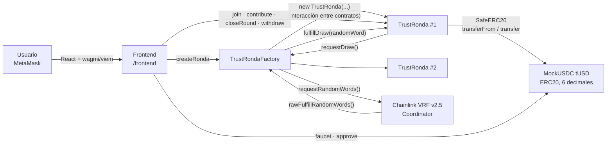

# TrustRonda

**Ronda de ahorro rotativo on-chain, sin nadie que guarde la plata.**

Proyecto final del *Ethereum Developer Pack, Nivel 2: Smart Contract Developer* (ETH Kipu / Talento Tech, 2026).
Autor: Carlos Binker.

> Red: **Sepolia** · Contratos: **Solidity 0.8.24 + OpenZeppelin 5.1 + Chainlink VRF v2.5** · Framework: **Foundry** · Frontend: **React + Vite + wagmi/viem**
> Tests: **70 pasan** · Coverage: **100 %** en líneas, statements, branches y funciones · Slither: **sin findings High ni Medium**

---

## Índice

1. [Qué hace y por qué blockchain](#1-qué-hace-y-por-qué-blockchain)
2. [Arquitectura](#2-arquitectura)
3. [Estructura del repositorio](#3-estructura-del-repositorio)
4. [Instalación y compilación](#4-instalación-y-compilación)
5. [Tests y coverage](#5-tests-y-coverage)
6. [Slither](#6-slither)
7. [Deploy y verificación en Sepolia](#7-deploy-y-verificación-en-sepolia)
8. [Cómo usar el proyecto](#8-cómo-usar-el-proyecto)
9. [Red y direcciones desplegadas](#9-red-y-direcciones-desplegadas)
10. [Transacciones reales del flujo principal](#10-transacciones-reales-del-flujo-principal)
11. [Decisiones de diseño y seguridad](#11-decisiones-de-diseño-y-seguridad)
12. [Warnings analizados](#12-warnings-analizados)
13. [Limitaciones conocidas del MVP](#13-limitaciones-conocidas-del-mvp)
14. [Roadmap](#14-roadmap)
15. [Documentación adicional](#15-documentación-adicional)

---

## 1. Qué hace y por qué blockchain

### El problema
La **ronda** (también llamada *tanda*, *pasanaku*, *junta* o *ROSCA*) es una forma de ahorro muy usada en Latinoamérica: un grupo aporta el mismo monto todos los meses y en cada turno uno de los miembros se lleva el pozo. Funciona con dos supuestos frágiles:

- **Alguien guarda la plata.** El organizador junta los aportes y los entrega. Si desaparece, se pierde todo.
- **Todos pagan hasta el final.** El que ya cobró tiene incentivos para dejar de pagar, y los últimos son los que más arriesgan.

### La solución
TrustRonda reemplaza al organizador por un smart contract:

- Los aportes los custodia **el contrato**, no una persona. Nadie, ni el organizador ni el owner de la factory, puede mover fondos ajenos.
- Al inscribirse, cada miembro deja una **garantía**. Si no paga un turno a tiempo, el contrato ejecuta su garantía y **el beneficiario cobra igual**.
- El **orden de cobro se sortea con Chainlink VRF**: un número aleatorio verificable que nadie, ni el organizador ni los miembros ni el owner, puede elegir ni anticipar. Así nadie se asegura cobrar primero.
- Cada paso emite un **evento**: cualquiera puede auditar quién pagó, quién cobró y cuándo.

### Por qué tiene sentido en Web3
| Necesidad de la ronda | Qué aporta la blockchain |
|---|---|
| Custodia sin intermediario de confianza | El contrato retiene los fondos y solo los libera según reglas públicas |
| Reglas que nadie puede cambiar a mitad de camino | Parámetros `immutable`; sin owner sobre las rondas |
| Penalizar al que no paga sin juicios ni reclamos | Ejecución automática de la garantía en `closeRound` |
| Un sorteo del orden que nadie pueda arreglar | Chainlink VRF: aleatoriedad con prueba criptográfica verificada on-chain |
| Transparencia entre personas que no se conocen | Historial completo en eventos, verificable en Etherscan |
| Acceso con solo una wallet | Sin cuenta bancaria ni KYC; aportes en stablecoin |

---

## 2. Arquitectura



| Contrato | Rol | Herencia (OpenZeppelin 5.1) |
|---|---|---|
| [`TrustRonda`](contracts/TrustRonda.sol) | **Contrato principal.** Una ronda: inscripción con garantía, sorteo del orden, aportes por turno, cierre de turno con ejecución de garantías y retiros (pull payment). | `ReentrancyGuard`, `SafeERC20` |
| [`TrustRondaFactory`](contracts/TrustRondaFactory.sol) | Crea rondas con `new`, lleva un registro paginado y una lista blanca de tokens, y es el **único consumidor de Chainlink VRF**: pide el número aleatorio de cada ronda y se lo entrega. | `Ownable`, `IVRFCoordinatorV2Plus` |
| [`MockUSDC`](contracts/MockUSDC.sol) | Stablecoin de prueba (tUSD, 6 decimales) con faucet de 1.000 tUSD por día, para que cualquiera pruebe la demo. | `ERC20` |

### Ciclo de vida de una ronda

```mermaid
stateDiagram-v2
    [*] --> Open: factory.createRonda()
    Open --> Open: join() (garantía)
    Open --> Drawing: join() del último miembro → pide el sorteo a Chainlink VRF
    Drawing --> Active: fulfillDraw() (llega el número aleatorio; se sortea el orden)
    Drawing --> Cancelled: cancel() si VRF no respondió en DRAW_TIMEOUT (1 día)
    Open --> Cancelled: cancel() (organizador, o cualquiera después de joinDeadline)
    Active --> Active: contribute() / closeRound() → turno siguiente
    Active --> Completed: closeRound() del último turno
    Completed --> [*]: withdraw() (pozos + garantía)
    Cancelled --> [*]: withdraw() (garantía)
```



### Flujo principal (ejemplo con 3 miembros, aporte 100, garantía 100)

1. **Crear:** el organizador llama a `factory.createRonda(tUSD, 100, 100, 3, 1 día, 7 días)`.
2. **Inscribirse:** Alice, Bob y Carol hacen `approve` y `join()`; cada uno deja 100 de garantía. Con Carol se completa el cupo: la ronda pasa a `Drawing` y la factory le pide un número aleatorio a **Chainlink VRF**.
3. **Sorteo:** unos bloques después, VRF responde y la ronda sortea el orden de cobro. Por ejemplo: Bob, Carol, Alice. Arranca el turno 1.
4. **Turno 1:** los tres llaman a `contribute()` (100 cada uno). Cualquiera llama a `closeRound()`: se acreditan 300 a Bob.
5. **Turno 2:** idem, cobra Carol. Si Alice no paga, al vencer el turno se ejecutan 100 de su garantía y Carol cobra los 300 igual.
6. **Turno 3:** cobra Alice. La ronda pasa a `Completed`.
7. **Retirar:** cada uno llama a `withdraw()` y se lleva su pozo y lo que le quede de garantía.

### Roles y privilegios

| Rol | Puede | No puede |
|---|---|---|
| Organizador de una ronda | Cancelarla mientras está en `Open` | Mover fondos, cambiar parámetros ni el orden |
| Miembro | `join`, `contribute`, `withdraw` de lo propio | Cobrar fuera de su turno ni elegir su lugar en el sorteo |
| Cualquier cuenta | `closeRound` cuando corresponde; `cancel` después de `joinDeadline` o si VRF no respondió en 1 día | Nada sobre fondos ajenos |
| Owner de la factory | `setTokenAllowed` (lista blanca de tokens para rondas **futuras**) | Tocar rondas existentes, sus fondos ni el sorteo (el coordinador de VRF es `immutable`) |
| Coordinador de Chainlink VRF | Entregar el número aleatorio (`rawFulfillRandomWords`) | Nada más: solo puede responder pedidos que existen |

---

## 3. Estructura del repositorio

```
trustronda-n2/
├── contracts/              # Solidity con NatSpec completo
│   ├── TrustRonda.sol
│   ├── TrustRondaFactory.sol
│   ├── MockUSDC.sol
│   └── interfaces/ITrustRondaDrawer.sol
├── test/                   # Foundry: unit, integración, fuzz e invariant
│   ├── TrustRonda.t.sol
│   ├── TrustRondaFactory.t.sol
│   ├── MockUSDC.t.sol
│   ├── TrustRonda.fuzz.t.sol
│   ├── invariant/          # Handler + invariantes de solvencia
│   └── utils/BaseTest.sol
├── script/
│   ├── Deploy.s.sol        # deploy + verificación
│   ├── Demo.s.sol          # flujo completo on-chain con 2 wallets (DemoStart / DemoFinish)
│   └── verify-ronda.sh     # verifica rondas creadas por la factory
├── deployments/            # direcciones por chainId (las genera Deploy)
├── frontend/               # dApp React + Vite + wagmi/viem
├── docs/                   # whitepaper, Slither, explicación, guion del video
├── foundry.toml · Makefile · .env.example
└── lib/                    # submódulos: openzeppelin-contracts v5.1.0, forge-std v1.9.6, chainlink-brownie-contracts 1.3.0
```

---

## 4. Instalación y compilación

**Requisitos:** [Foundry](https://book.getfoundry.sh/getting-started/installation), Node.js 20 o superior, Git y, para Slither, Python 3 con `pip`.

```bash
git clone --recurse-submodules https://github.com/<TU_USUARIO>/trustronda-n2.git
cd trustronda-n2

# si se clonó sin --recurse-submodules:
git submodule update --init --recursive

forge build                 # o: make build
```

El proyecto compila **sin warnings** de solc ni de `forge lint` (ver [Warnings analizados](#12-warnings-analizados)).

---

## 5. Tests y coverage

```bash
forge test -vv                                     # o: make test
forge coverage --no-match-coverage "(script|test|lib)" # o: make coverage
forge test --gas-report                            # consumo de gas por función
```

**Resultado:** 70 tests, 0 fallas ([`docs/reports/forge-test.txt`](docs/reports/forge-test.txt)).

| Suite | Tests | Qué cubre |
|---|---|---|
| `TrustRonda.t.sol` | 42 | Flujo completo de punta a punta, sorteo con VRF (permutación, estado `Drawing`, sorteo tardío ignorado, cancelación por timeout), cada función en su camino exitoso y en cada revert (custom errors con parámetros), eventos (`vm.expectEmit`), ejecución de garantías y las 11 validaciones del constructor |
| `TrustRondaFactory.t.sol` | 16 | Creación y registro (interacción entre contratos), configuración de VRF, `requestDraw` solo para rondas propias, callback solo del coordinador, lista blanca, permisos del owner, paginación |
| `MockUSDC.t.sol` | 4 | Faucet y cooldown |
| `TrustRonda.fuzz.t.sol` | 4 × 512 corridas | **Conservación del dinero** con parámetros, número de VRF y patrones de pago aleatorios (`bound`); todos terminan con su saldo si todos pagan; **el sorteo siempre es una permutación** y entra en el gas del callback; no se puede cerrar antes de tiempo |
| `invariant/` | 4 × 128 × 64 llamadas (incluye el callback de VRF) | **Solvencia exacta:** saldo del token = pozos acreditados + garantías + aportes del turno abierto; cupo, turnos y garantías dentro de sus límites |

**Coverage del código propio** ([`docs/reports/coverage.txt`](docs/reports/coverage.txt)):

| Archivo | Líneas | Statements | Branches | Funciones |
|---|---|---|---|---|
| `MockUSDC.sol` | 100 % (9/9) | 100 % (10/10) | 100 % (1/1) | 100 % (2/2) |
| `TrustRonda.sol` | 100 % (143/143) | 100 % (171/171) | 100 % (31/31) | 100 % (19/19) |
| `TrustRondaFactory.sol` | 100 % (43/43) | 100 % (47/47) | 100 % (8/8) | 100 % (7/7) |
| **Total** | **100 %** | **100 %** | **100 %** | **100 %** |

Se excluyen `test/` y `script/` (código auxiliar) y `lib/` (librerías de terceros, incluido el mock de Chainlink), como permite el enunciado. Los tests simulan al oráculo con el **mock oficial de Chainlink** (`VRFCoordinatorV2_5Mock`).

---

## 6. Slither

```bash
pip install slither-analyzer
slither . --filter-paths "lib|test|script" --exclude-dependencies   # o: make slither
# formato checklist, como pidió el profesor en la mentoría:
slither . --filter-paths "lib|test|script" --exclude-dependencies --checklist > docs/reports/slither-checklist.md   # o: make slither-checklist
```

| Detector | Severidad | Estado |
|---|---|---|
| `uninitialized-local` (`closeRound`) | Medium | **Corregido** |
| `timestamp` (×5: `join`, `contribute`, `closeRound`, `cancel`, `faucet`) | Low | **Aceptado**, con justificación técnica |
| `reentrancy-benign` / `reentrancy-events` (`requestDraw`) | Low | **Aceptado**: el requestId solo se conoce después de llamar al coordinador de VRF, que es un contrato de Chainlink confiable e `immutable` |
| `unused-return` (`join` → `requestDraw`) | Medium | **Corregido**: `requestDraw` ya no devuelve el requestId (queda en `drawRequestOf`) |

Justificación de los `timestamp`, en resumen: se usa `block.timestamp` para **plazos de calendario** (mínimo 5 minutos, típicamente días), no para aleatoriedad. El margen de manipulación de un proposer es de segundos, ningún monto se calcula con el tiempo, y el peor caso es darle unos segundos más a alguien para pagar. Informe completo con la revisión manual: [`docs/slither.md`](docs/slither.md). Salida en formato checklist: [`docs/reports/slither-checklist.md`](docs/reports/slither-checklist.md).

---

## 7. Deploy y verificación en Sepolia

1. **Crear la suscripción de Chainlink VRF.** En [vrf.chain.link](https://vrf.chain.link), red Sepolia, con la **misma wallet** que va a desplegar: *Create Subscription* y fondearla con LINK de testnet ([faucets.chain.link/sepolia](https://faucets.chain.link/sepolia)). Copiar el **Subscription ID**.
2. Copiar las variables de entorno y completarlas. **`.env` está en `.gitignore`: nunca se commitea.**
   ```bash
   cp .env.example .env
   # SEPOLIA_RPC_URL, PRIVATE_KEY (wallet SOLO de testnet), ETHERSCAN_API_KEY
   # PRIVATE_KEY_2 (segunda wallet de testnet, solo para la demo por script)
   # VRF_SUBSCRIPTION_ID (paso 1), VRF_NATIVE_PAYMENT=false (paga en LINK)
   ```
   El coordinador y el key hash de Sepolia vienen por defecto, con los valores oficiales de [docs.chain.link](https://docs.chain.link/vrf/v2-5/supported-networks): coordinador `0x9DdfaCa8183c41ad55329BdeeD9F6A8d53168B1B` y gas lane de 500 gwei.
3. Desplegar y verificar MockUSDC y TrustRondaFactory. El script también **agrega la factory como consumidor** de la suscripción:
   ```bash
   make deploy
   # = forge script script/Deploy.s.sol --rpc-url sepolia --broadcast --verify -vvv
   ```
   Las direcciones quedan en `deployments/11155111.json` y las transacciones en `broadcast/Deploy.s.sol/11155111/`.
   En vrf.chain.link, la factory tiene que aparecer como *consumer* de la suscripción.
4. Ejecutar el flujo principal on-chain en dos pasos (la respuesta de VRF llega unos bloques después):
   ```bash
   make demo-start                    # crea una ronda de 2 y la llena → pide el sorteo
   # esperar 1-2 minutos (el pedido se ve en vrf.chain.link)
   make demo-finish RONDA=0x...       # 2 turnos completos y retiros, en el orden sorteado
   ```
5. Verificar las rondas creadas por la factory. Se despliegan con `new`, así que `--verify` no las cubre:
   ```bash
   make verify-ronda RONDA=0x...
   ```

---

## 8. Cómo usar el proyecto

### Frontend local
```bash
cd frontend
cp .env.example .env.local      # completar con deployments/11155111.json
npm install
npm run dev                     # http://localhost:5173
```

| Variable | Valor |
|---|---|
| `VITE_CHAIN_ID` | `11155111` (Sepolia) |
| `VITE_FACTORY_ADDRESS` | dirección de `TrustRondaFactory` |
| `VITE_USDC_ADDRESS` | dirección de `MockUSDC` |
| `VITE_DEPLOY_BLOCK` | `deployBlock` del JSON (desde ahí se leen los eventos) |
| `VITE_RPC_URL` | opcional: RPC propio para lecturas |

Frontend desplegado: **PENDIENTE: completar con la URL de Vercel** (opcional según el checklist).

### Paso a paso en la dApp
1. **Conectar wallet** (MetaMask en Sepolia; si está en otra red, aparece el botón para cambiar).
2. **Pedir 1.000 tUSD de prueba** con el faucet.
3. **Crear una ronda:** aporte, garantía, cupo y duración. Para la demo, 2 miembros y turnos de 5 minutos.
4. Con cada cuenta: **Inscribirme**. La dApp manda `approve` y después `join`.
5. En cada turno: **Pagar** (`approve` + `contribute`) con cada miembro, y después **Cerrar turno** (lo puede hacer cualquiera).
6. **Retirar** el pozo cobrado y, al terminar, la garantía.

La **rueda** muestra los lugares en orden de cobro: los que ya cobraron, el turno en curso, quién pagó y quién tuvo impagos. El **historial on-chain** lista los eventos del contrato con el link de cada transacción en Etherscan.

---

## 9. Red y direcciones desplegadas

**Red:** Ethereum Sepolia (chainId `11155111`)

| Contrato | Dirección | Código verificado |
|---|---|---|
| MockUSDC (tUSD) | **PENDIENTE: completar tras `make deploy`** | `https://sepolia.etherscan.io/address/<DIRECCION>#code` |
| TrustRondaFactory | **PENDIENTE** | `https://sepolia.etherscan.io/address/<DIRECCION>#code` |
| TrustRonda (ronda de la demo) | **PENDIENTE: la imprime `make demo-start`** | `https://sepolia.etherscan.io/address/<DIRECCION>#code` |
| Chainlink VRF v2.5 Coordinator (externo, de Chainlink) | `0x9DdfaCa8183c41ad55329BdeeD9F6A8d53168B1B` | [docs.chain.link](https://docs.chain.link/vrf/v2-5/supported-networks) |
| Suscripción de VRF | **PENDIENTE: Subscription ID** | `https://vrf.chain.link/sepolia/<SUBSCRIPTION_ID>` |

---

## 10. Transacciones reales del flujo principal

Las generan `make demo-start` y `make demo-finish` (están en `broadcast/Demo.s.sol/11155111/`) o el frontend (se ven en el historial de cada ronda).

| Paso | Función | Tx |
|---|---|---|
| Crear ronda | `TrustRondaFactory.createRonda` | **PENDIENTE** |
| Inscripción miembro 1 | `TrustRonda.join` | **PENDIENTE** |
| Inscripción miembro 2 (completa el cupo y pide el sorteo) | `TrustRonda.join` → `TrustRondaFactory.requestDraw` → VRF | **PENDIENTE** |
| Sorteo del orden (respuesta de Chainlink VRF) | `rawFulfillRandomWords` → `TrustRonda.fulfillDraw` | **PENDIENTE** (tx del coordinador; se ve en la pestaña *Internal Txns* o en vrf.chain.link) |
| Aporte turno 1 | `TrustRonda.contribute` | **PENDIENTE** |
| Cierre turno 1 | `TrustRonda.closeRound` | **PENDIENTE** |
| Retiro del pozo | `TrustRonda.withdraw` | **PENDIENTE** |
| Cierre turno 2 (Completed) | `TrustRonda.closeRound` | **PENDIENTE** |
| Retiro final | `TrustRonda.withdraw` | **PENDIENTE** |

---

## 11. Decisiones de diseño y seguridad

| Ítem del checklist (B) | Cómo se cumple |
|---|---|
| NatSpec completo | Contratos, variables de estado, structs, eventos y sus parámetros, custom errors y sus parámetros, modifiers, funciones con `@param` y `@return`. Los roles están en el `@dev` de cada contrato. |
| Custom errors | 16 en `TrustRonda`, 5 en la factory y 1 en el token, con parámetros (`InvalidStatus(expected, actual)`, `RoundStillOpen(deadline)`…). Ningún `require` con string. |
| Strings y bytes largos | No hay. |
| Lecturas repetidas de storage | Se cachean en locales (`round`, `paid`, `deadline`, `amount` en `closeRound`). |
| storage / memory / calldata | `MemberInfo storage info` para modificar en el lugar; `memory` solo en los retornos de las views. |
| `constant` / `immutable` | Límites como `constant` (`MAX_MEMBERS`, `MIN_DURATION`…); los 7 parámetros de la ronda como `immutable`. |
| Empaquetado de storage | `status`, `currentRound`, `paidCount` y `roundDeadline` en **un slot**; `MemberInfo` (uint128 + uint8 + uint8 + bool) en **un slot**. |
| Visibilidad y mutabilidad | `external` para la API, `internal view` para helpers, `pure` en `decimals()`, estado `private` con getters. |
| Eventos | 11 eventos en `TrustRonda` y 4 en la factory, con `indexed` en direcciones, turnos y requestIds; el frontend arma el historial con ellos. |
| Aleatoriedad | Chainlink VRF v2.5 (no `block.timestamp` ni `blockhash`, que el proposer puede influir). Coordinador `immutable` y callback que solo acepta al coordinador. |
| CEI | `join`, `contribute` y `withdraw` siguen *checks → effects → interactions*; `closeRound` no hace llamadas externas. |
| Reentrancy | `nonReentrant` en las tres funciones que transfieren, además de CEI. |
| Control de acceso | `Ownable` (OZ v5, `initialOwner` explícito) solo en la factory, con un único privilegio; sin owner en las rondas. |
| SafeERC20 | Todas las transferencias de la ronda usan `safeTransfer` / `safeTransferFrom`. |
| Pull payments | Pozos y garantías se acreditan y cada uno los retira: ningún receptor puede bloquear a otro. |
| DoS por loops | Loops acotados por `MAX_MEMBERS = 12` (`closeRound`, sorteo Fisher-Yates); `getRondas` paginado. El callback de VRF con 12 miembros queda por debajo de 225 k de gas (límite: 300 k). |
| `unchecked` | Solo en contadores acotados por 12 y en restas ya validadas, cada uno con comentario. |
| `tx.origin`, `delegatecall`, `selfdestruct`, assembly | No se usan. |
| Proxies | No se usan: la ronda es inmutable a propósito (nadie puede cambiar las reglas a mitad de la ronda). |

**Gas** (`forge test --gas-report`): `join` mediana 129 k (máx. 286 k, el último, que además pide el sorteo) · `contribute` 73 k · `closeRound` 58 k (máx. 200 k con 12 impagos) · `withdraw` 46 k · `createRonda` 1,5 M (despliega una ronda).

---

## 12. Warnings analizados

| Origen | Warning | Decisión |
|---|---|---|
| `forge lint` | `unsafe-typecast` en los casts a `uint8` y `uint128` de `join` y `closeRound` | Seguros: los valores están acotados por `MAX_MEMBERS` y por la validación del constructor. Se justifican con `forge-lint: disable-next-line` y un comentario. |
| `forge lint` | `screaming-snake-case-immutable` | Excluido en `foundry.toml`: los `immutable` (`token`, `contributionAmount`…) son la API pública que lee el frontend y se leen como parámetros, no como constantes. |
| `forge lint` | `unsafe-cheatcode` (`vm.readFile` en `Demo.s.sol`) | Intencional, limitado por `fs_permissions` a `./deployments`. |
| `forge lint` | `unwrapped-modifier-logic` | **Corregido:** la lógica de los modifiers se movió a `_checkStatus` y `_checkMember`. |
| Vite | Chunk > 500 kB | viem + wagmi pesan unos 180 kB gzip. Es aceptable para una dApp de una página, así que se subió el umbral. |

---

## 13. Limitaciones conocidas del MVP

- **El sorteo depende de la suscripción de VRF.** Si se queda sin LINK, el pedido queda pendiente. Para que la garantía no quede trabada, después de 1 día cualquiera puede cancelar la ronda. El costo del sorteo lo paga hoy el dueño de la suscripción. → Roadmap: cobrar una pequeña comisión a los miembros para financiarla.
- **La garantía cubre un número limitado de impagos.** Con garantía igual a un aporte, alcanza para un impago. Después, el pozo de los turnos siguientes sale más chico. → Roadmap: garantía proporcional a los turnos restantes y exclusión del moroso.
- **Un miembro que ya cobró y deja de pagar** solo pierde su garantía. El contrato no puede perseguirlo fuera de la cadena. → Roadmap: garantía decreciente y reputación on-chain.
- **El cierre del turno depende de que alguien llame a `closeRound`.** Puede hacerlo cualquiera, pero no se dispara solo. → Roadmap: Chainlink Automation.
- **Un solo token (tUSD de prueba)** en la lista blanca. La factory permite agregar USDC real con `setTokenAllowed`.
- **Máximo 12 miembros** por ronda, para acotar el gas del loop.
- **El frontend lee los eventos con `getLogs`.** Con muchas rondas o un RPC público restrictivo puede ser lento. → Roadmap: indexador (The Graph).

---

## 14. Roadmap

**Fase 2: robustez del protocolo**
- Cierre automático de turnos con **Chainlink Automation** (`checkUpkeep` / `performUpkeep` sobre `closeRound`).
- Garantía dinámica: proporcional a lo que falta pagar, y que decrezca para quien ya pagó más de lo que cobró.
- Exclusión del miembro con dos impagos (deja de recibir el pozo, que se reparte).

**Fase 3: producto**
- Soporte de **USDC real** en una L2 (Base o Arbitrum) para bajar el costo por transacción.
- Rondas privadas por invitación (allowlist con firma EIP-712) y `permit` (EIP-2612) para ahorrar el `approve`.
- Reputación on-chain: historial de rondas cumplidas como credencial (SBT).
- Indexador con The Graph y notificaciones de vencimiento.

**Seguridad y escalabilidad**
- Auditoría externa y testing formal de las invariantes (Halmos o Certora).
- Clones mínimos (EIP-1167) en la factory para bajar el costo de crear una ronda (hoy ~1,2 M de gas, porque se despliega el bytecode completo).
- Si se agregan funciones administrativas, pasar a `AccessControl` con multisig y timelock.

---

## 15. Documentación adicional

- [`docs/whitepaper.md`](docs/whitepaper.md): problema, solución, arquitectura implementada, seguridad, riesgos y roadmap.
- [`docs/explicacion-del-proyecto.md`](docs/explicacion-del-proyecto.md): explicación detallada de cada parte del código.
- [`docs/slither.md`](docs/slither.md): informe de análisis estático.
- [`docs/guion-video.md`](docs/guion-video.md): guion del video de 5 minutos.
- [`docs/guia-entrega.md`](docs/guia-entrega.md): pasos para desplegar, verificar, publicar en GitHub y entregar.
- [`docs/practica-remix.md`](docs/practica-remix.md): práctica guiada para jugar una ronda a mano en Remix VM.

## Licencia

MIT
