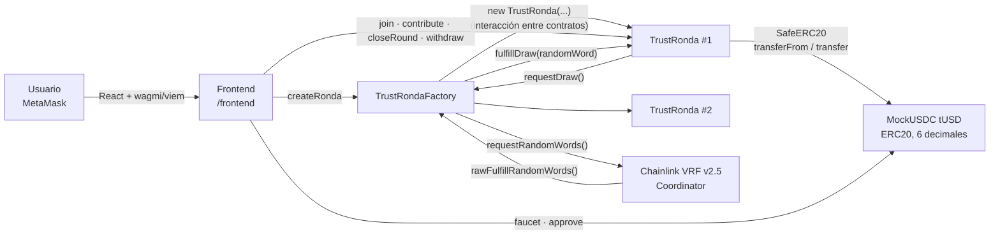

# TrustRonda

**Ronda de ahorro rotativo on-chain, sin nadie que guarde la plata.**

Proyecto final del *Ethereum Developer Pack, Nivel 2: Smart Contract Developer* (ETH Kipu / Talento Tech, 2026).
Autor: Carlos Binker.

**dApp en vivo (Sepolia): https://trustronda-n2.vercel.app** · necesita MetaMask en la red Sepolia. MetaMask marca el dominio con una alerta de phishing (falso positivo, ver sección 8); para firmar transacciones conviene el frontend local.

> Red: **Sepolia** · Contratos: **Solidity 0.8.24 + OpenZeppelin 5.1 + Chainlink VRF v2.5** · Framework: **Foundry** · Frontend: **React + Vite + wagmi/viem**
> Tests: **67 pasan** · Coverage: **100 %** en líneas, statements, branches y funciones · Slither: **sin findings High ni Medium**

---

## Índice

1. [Qué hace y por qué blockchain](#1-qué-hace-y-por-qué-blockchain)
2. [Arquitectura](#2-arquitectura)
3. [Estructura del repositorio](#3-estructura-del-repositorio)
4. [Instalación y compilación](#4-instalación-y-compilación)
5. [Tests y coverage](#5-tests-y-coverage)
6. [Slither](#6-slither)
7. [Deploy y verificación en Sepolia](#7-deploy-y-verificación-en-sepolia)
8. [Cómo usar el proyecto](#8-cómo-usar-el-proyecto)
9. [Red y direcciones desplegadas](#9-red-y-direcciones-desplegadas)
10. [Transacciones reales del flujo principal](#10-transacciones-reales-del-flujo-principal)
11. [Decisiones de diseño y seguridad](#11-decisiones-de-diseño-y-seguridad)
12. [Warnings analizados](#12-warnings-analizados)
13. [Limitaciones conocidas del MVP](#13-limitaciones-conocidas-del-mvp)
14. [Roadmap](#14-roadmap)
15. [Documentación adicional](#15-documentación-adicional)

---

## 1. Qué hace y por qué blockchain

### El problema
La **ronda** (también llamada *tanda*, *pasanaku*, *junta* o *ROSCA*) es una forma de ahorro muy usada en Latinoamérica: un grupo aporta el mismo monto todos los meses y en cada turno uno de los miembros se lleva el pozo. Funciona con dos supuestos frágiles:

- **Alguien guarda la plata.** El organizador junta los aportes y los entrega. Si desaparece, se pierde todo.
- **Todos pagan hasta el final.** El que ya cobró tiene incentivos para dejar de pagar, y los últimos son los que más arriesgan.

### La solución
TrustRonda reemplaza al organizador por un smart contract:

- Los aportes los custodia **el contrato**, no una persona. Nadie, ni el organizador ni el owner de la factory, puede mover fondos ajenos.
- Al inscribirse, cada miembro deja una **garantía**. Si no paga un turno a tiempo, el contrato ejecuta su garantía y **el beneficiario cobra igual**.
- El **orden de cobro se sortea con Chainlink VRF**: un número aleatorio verificable que nadie, ni el organizador ni los miembros ni el owner, puede elegir ni anticipar. Así nadie se asegura cobrar primero.
- Cada paso emite un **evento**: cualquiera puede auditar quién pagó, quién cobró y cuándo.

### Por qué tiene sentido en Web3
| Necesidad de la ronda | Qué aporta la blockchain |
|---|---|
| Custodia sin intermediario de confianza | El contrato retiene los fondos y solo los libera según reglas públicas |
| Reglas que nadie puede cambiar a mitad de camino | Parámetros `immutable`; sin owner sobre las rondas |
| Penalizar al que no paga sin juicios ni reclamos | Ejecución automática de la garantía en `closeRound` |
| Un sorteo del orden que nadie pueda arreglar | Chainlink VRF: aleatoriedad con prueba criptográfica verificada on-chain |
| Transparencia entre personas que no se conocen | Historial completo en eventos, verificable en Etherscan |
| Acceso con solo una wallet | Sin cuenta bancaria ni KYC; aportes en stablecoin |

---

## 2. Arquitectura



| Contrato | Rol | Herencia (OpenZeppelin 5.1) |
|---|---|---|
| [`TrustRonda`](contracts/TrustRonda.sol) | **Contrato principal.** Una ronda: inscripción con garantía, sorteo del orden, aportes por turno, cierre de turno con ejecución de garantías y retiros (pull payment). | `ReentrancyGuard`, `SafeERC20` |
| [`TrustRondaFactory`](contracts/TrustRondaFactory.sol) | Crea rondas con `new`, lleva un registro paginado y una lista blanca de tokens, y es el **único consumidor de Chainlink VRF**: pide el número aleatorio de cada ronda y se lo entrega. | `Ownable`, `IVRFCoordinatorV2Plus` |
| [`MockUSDC`](contracts/MockUSDC.sol) | Stablecoin de prueba (tUSD, 6 decimales) con faucet de 1.000 tUSD por día, para que cualquiera pruebe la demo. | `ERC20` |

### Ciclo de vida de una ronda

```mermaid
stateDiagram-v2
    [*] --> Open: factory.createRonda()
    Open --> Open: join() (garantía)
    Open --> Drawing: join() del último miembro → pide el sorteo a Chainlink VRF
    Drawing --> Active: fulfillDraw() (llega el número aleatorio; se sortea el orden)
    Drawing --> Cancelled: cancel() si VRF no respondió en DRAW_TIMEOUT (1 día)
    Open --> Cancelled: cancel() (organizador, o cualquiera después de joinDeadline)
    Active --> Active: contribute() / closeRound() → turno siguiente
    Active --> Completed: closeRound() del último turno
    Completed --> [*]: withdraw() (pozos + garantía)
    Cancelled --> [*]: withdraw() (garantía)
```



### Flujo principal (ejemplo con 3 miembros, aporte 100, garantía 100)

1. **Crear:** el organizador llama a `factory.createRonda(tUSD, 100, 100, 3, 1 día, 7 días)`.
2. **Inscribirse:** Alice, Bob y Carol hacen `approve` y `join()`; cada uno deja 100 de garantía. Con Carol se completa el cupo: la ronda pasa a `Drawing` y la factory le pide un número aleatorio a **Chainlink VRF**.
3. **Sorteo:** unos bloques después, VRF responde y la ronda sortea el orden de cobro. Por ejemplo: Bob, Carol, Alice. Arranca el turno 1.
4. **Turno 1:** los tres llaman a `contribute()` (100 cada uno). Cualquiera llama a `closeRound()`: se acreditan 300 a Bob.
5. **Turno 2:** idem, cobra Carol. Si Alice no paga, al vencer el turno se ejecutan 100 de su garantía y Carol cobra los 300 igual.
6. **Turno 3:** cobra Alice. La ronda pasa a `Completed`.
7. **Retirar:** cada uno llama a `withdraw()` y se lleva su pozo y lo que le quede de garantía.

### Roles y privilegios

| Rol | Puede | No puede |
|---|---|---|
| Organizador de una ronda | Cancelarla mientras está en `Open` | Mover fondos, cambiar parámetros ni el orden |
| Miembro | `join`, `contribute`, `withdraw` de lo propio | Cobrar fuera de su turno ni elegir su lugar en el sorteo |
| Cualquier cuenta | `closeRound` cuando corresponde; `cancel` después de `joinDeadline` o si VRF no respondió en 1 día | Nada sobre fondos ajenos |
| Owner de la factory | `setTokenAllowed` (lista blanca de tokens para rondas **futuras**) | Tocar rondas existentes, sus fondos ni el sorteo (el coordinador de VRF es `immutable`) |
| Coordinador de Chainlink VRF | Entregar el número aleatorio (`rawFulfillRandomWords`) | Nada más: solo puede responder pedidos que existen |

---

## 3. Estructura del repositorio

```
trustronda-n2/
├── contracts/              # Solidity con NatSpec completo
│   ├── TrustRonda.sol
│   ├── TrustRondaFactory.sol
│   ├── MockUSDC.sol
│   └── interfaces/ITrustRondaDrawer.sol
├── test/                   # Foundry: unit, integración, fuzz e invariant
│   ├── TrustRonda.t.sol
│   ├── TrustRondaFactory.t.sol
│   ├── MockUSDC.t.sol
│   ├── TrustRonda.fuzz.t.sol
│   ├── invariant/          # Handler + invariantes de solvencia
│   └── utils/BaseTest.sol
├── script/
│   ├── Deploy.s.sol        # deploy + verificación
│   ├── Demo.s.sol          # flujo completo on-chain con 2 wallets (DemoStart / DemoFinish)
│   └── verify-ronda.sh     # verifica rondas creadas por la factory
├── deployments/            # direcciones por chainId (las genera Deploy)
├── frontend/               # dApp React + Vite + wagmi/viem
├── docs/                   # whitepaper, Slither, explicación y checklist
├── foundry.toml · Makefile · .env.example
└── lib/                    # submódulos: openzeppelin-contracts v5.1.0, forge-std v1.9.6, chainlink-brownie-contracts 1.3.0
```

---

## 4. Instalación y compilación

**Requisitos:** [Foundry](https://book.getfoundry.sh/getting-started/installation), Node.js 20 o superior, Git y, para Slither, Python 3 con `pip`.

```bash
git clone --recurse-submodules https://github.com/<TU_USUARIO>/trustronda-n2.git
cd trustronda-n2

# si se clonó sin --recurse-submodules:
git submodule update --init --recursive

forge build                 # o: make build
```

El proyecto compila **sin warnings** de solc ni de `forge lint` (probado con Foundry 1.5.1 y 1.8.6; ver [Warnings analizados](#12-warnings-analizados)).

---

## 5. Tests y coverage

```bash
forge test -vv                                     # o: make test
forge coverage --no-match-coverage "(script|test|lib)" # o: make coverage
forge test --gas-report                            # consumo de gas por función
```

**Resultado:** 67 tests, 0 fallas, con Foundry 1.8.6 ([`docs/reports/forge-test.txt`](docs/reports/forge-test.txt)). Pasan igual con `make test-amsterdam`, las reglas de gas de Glamsterdam.

| Suite | Tests | Qué cubre |
|---|---|---|
| `TrustRonda.t.sol` | 42 | Flujo completo de punta a punta, sorteo con VRF (permutación, estado `Drawing`, sorteo tardío ignorado, cancelación por timeout), cada función en su camino exitoso y en cada revert (custom errors con parámetros), eventos (`vm.expectEmit`), ejecución de garantías y las 11 validaciones del constructor |
| `TrustRondaFactory.t.sol` | 16 | Creación y registro (interacción entre contratos), configuración de VRF, `requestDraw` solo para rondas propias, callback solo del coordinador, lista blanca, permisos del owner, paginación |
| `MockUSDC.t.sol` | 4 | Faucet y cooldown |
| `TrustRonda.fuzz.t.sol` | 4 × 512 corridas | **Conservación del dinero** con parámetros, número de VRF y patrones de pago aleatorios (`bound`); todos terminan con su saldo si todos pagan; **el sorteo siempre es una permutación** y entra en el gas del callback; no se puede cerrar antes de tiempo |
| `invariant/` | 4 × 128 × 64 llamadas (incluye el callback de VRF) | **Solvencia exacta:** saldo del token = pozos acreditados + garantías + aportes del turno abierto; cupo, turnos y garantías dentro de sus límites |

**Coverage del código propio** ([`docs/reports/coverage.txt`](docs/reports/coverage.txt)):

| Archivo | Líneas | Statements | Branches | Funciones |
|---|---|---|---|---|
| `MockUSDC.sol` | 100 % (10/10) | 100 % (10/10) | 100 % (1/1) | 100 % (3/3) |
| `TrustRonda.sol` | 100 % (145/145) | 100 % (175/175) | 100 % (33/33) | 100 % (20/20) |
| `TrustRondaFactory.sol` | 100 % (43/43) | 100 % (47/47) | 100 % (10/10) | 100 % (7/7) |
| **Total** | **100 %** | **100 %** | **100 %** | **100 %** |

Se excluyen `test/` y `script/` (código auxiliar) y `lib/` (librerías de terceros, incluido el mock de Chainlink), como permite el enunciado. Los tests simulan al oráculo con el **mock oficial de Chainlink** (`VRFCoordinatorV2_5Mock`).

---

## 6. Slither

```bash
pip install slither-analyzer
slither . --filter-paths "lib|test|script" --exclude-dependencies   # o: make slither
# formato checklist, como pidió el profesor en la mentoría:
slither . --filter-paths "lib|test|script" --exclude-dependencies --checklist > docs/reports/slither-checklist.md   # o: make slither-checklist
```

| Detector | Severidad | Estado |
|---|---|---|
| `uninitialized-local` (`closeRound`) | Medium | **Corregido** |
| `timestamp` (×5: `join`, `contribute`, `closeRound`, `cancel`, `faucet`) | Low | **Aceptado**, con justificación técnica |
| `reentrancy-benign` / `reentrancy-events` (`requestDraw`) | Low | **Aceptado**: el requestId solo se conoce después de llamar al coordinador de VRF, que es un contrato de Chainlink confiable e `immutable` |
| `unused-return` (`join` → `requestDraw`) | Medium | **Corregido**: `requestDraw` ya no devuelve el requestId (queda en `drawRequestOf`) |

Justificación de los `timestamp`, en resumen: se usa `block.timestamp` para **plazos de calendario** (mínimo 5 minutos, típicamente días), no para aleatoriedad. El margen de manipulación de un proposer es de segundos, ningún monto se calcula con el tiempo, y el peor caso es darle unos segundos más a alguien para pagar. Informe completo con la revisión manual: [`docs/slither.md`](docs/slither.md). Salida en formato checklist: [`docs/reports/slither-checklist.md`](docs/reports/slither-checklist.md).

---

## 7. Deploy y verificación en Sepolia

1. **Crear la suscripción de Chainlink VRF.** En [vrf.chain.link](https://vrf.chain.link), red Sepolia, con la **misma wallet** que va a desplegar: *Create Subscription* y fondearla con LINK de testnet ([faucets.chain.link/sepolia](https://faucets.chain.link/sepolia)). Copiar el **Subscription ID**.
2. Copiar las variables de entorno y completarlas. **`.env` está en `.gitignore`: nunca se commitea.**
   ```bash
   cp .env.example .env
   # SEPOLIA_RPC_URL, PRIVATE_KEY (wallet SOLO de testnet), ETHERSCAN_API_KEY
   # PRIVATE_KEY_2 (segunda wallet de testnet, solo para la demo por script)
   # VRF_SUBSCRIPTION_ID (paso 1), VRF_NATIVE_PAYMENT=false (paga en LINK)
   ```
   El coordinador y el key hash de Sepolia vienen por defecto, con los valores oficiales de [docs.chain.link](https://docs.chain.link/vrf/v2-5/supported-networks): coordinador `0x9DdfaCa8183c41ad55329BdeeD9F6A8d53168B1B` y gas lane de 500 gwei.
3. Desplegar y verificar MockUSDC y TrustRondaFactory. El script también **agrega la factory como consumidor** de la suscripción:
   ```bash
   make deploy
   # = forge script script/Deploy.s.sol --rpc-url sepolia --broadcast --verify -vvv
   ```
   Las direcciones quedan en `deployments/11155111.json` y las transacciones en `broadcast/Deploy.s.sol/11155111/`.
   En vrf.chain.link, la factory tiene que aparecer como *consumer* de la suscripción.
4. Ejecutar el flujo principal on-chain en dos pasos (la respuesta de VRF llega unos bloques después):
   ```bash
   make demo-start                    # crea una ronda de 2 y la llena → pide el sorteo
   # esperar 1-2 minutos (el pedido se ve en vrf.chain.link)
   make demo-finish RONDA=0x...       # 2 turnos completos y retiros, en el orden sorteado
   ```
5. Verificar las rondas creadas por la factory. Se despliegan con `new`, así que `--verify` no las cubre:
   ```bash
   make verify-ronda RONDA=0x... BLOCK=<bloque de la tx createRonda>
   ```
   El script reconstruye los argumentos del constructor con los getters de la ronda y verifica en Etherscan y Sourcify. `BLOCK` es opcional: sin él, busca el evento `RondaCreated` con `eth_getLogs`, que los RPC gratuitos limitan a rangos chicos (Alchemy free: 10 bloques por consulta).

### Ensayo local en anvil (opcional)
Para probar todo sin gastar en Sepolia, con el mock oficial de VRF:
```bash
anvil &                                         # nodo local con cuentas de prueba
cast rpc anvil_mine 5                           # el mock necesita blockhash del bloque anterior
export PRIVATE_KEY=<clave de la cuenta 0 de anvil> PRIVATE_KEY_2=<clave de la cuenta 1>
MOCK=$(forge create lib/chainlink-brownie-contracts/contracts/src/v0.8/vrf/mocks/VRFCoordinatorV2_5Mock.sol:VRFCoordinatorV2_5Mock \
  --rpc-url http://127.0.0.1:8545 --private-key $PRIVATE_KEY --broadcast \
  --constructor-args 100000000000000000 1000000000 4000000000000000 | grep "Deployed to" | awk '{print $3}')
cast send $MOCK "createSubscription()" --rpc-url http://127.0.0.1:8545 --private-key $PRIVATE_KEY
SUB=$(cast call $MOCK "getActiveSubscriptionIds(uint256,uint256)(uint256[])" 0 10 --rpc-url http://127.0.0.1:8545 | tr -d '[]')
cast send $MOCK "fundSubscription(uint256,uint256)" $SUB 1000000000000000000000 --rpc-url http://127.0.0.1:8545 --private-key $PRIVATE_KEY
VRF_COORDINATOR=$MOCK VRF_SUBSCRIPTION_ID=$SUB VRF_KEY_HASH=0x0000000000000000000000000000000000000000000000000000000000000001 \
  forge script script/Deploy.s.sol --rpc-url http://127.0.0.1:8545 --broadcast
forge script script/Demo.s.sol:DemoStart --rpc-url http://127.0.0.1:8545 --broadcast
# hacer de oráculo: requestId = factory.drawRequestOf(ronda)
cast send $MOCK "fulfillRandomWords(uint256,address)" <REQUEST_ID> <FACTORY> --rpc-url http://127.0.0.1:8545 --private-key $PRIVATE_KEY
RONDA=<ronda> forge script script/Demo.s.sol:DemoFinish --rpc-url http://127.0.0.1:8545 --broadcast
```

### Lo que pasó en el deploy real (lecciones)

**1. Glamsterdam cambió el costo de gas en Sepolia.** Desde el 06/10/2026 Sepolia tiene activo el fork Glamsterdam (EIP-8037): desplegar código cuesta 1.530 gas por byte (antes 200), crear una cuenta 183.600 (antes 32.000) y una celda nueva de storage 97.920 (antes 20.000). El primer `make deploy` falló con *"contract creation code storage out of gas"* porque Foundry simulaba con las reglas viejas y estimaba de menos (los intentos fallidos quedan en `broadcast/Deploy.s.sol/11155111/`). Cambios:
- Los scripts de Sepolia corren con `--hardfork amsterdam --gas-estimate-multiplier 150` (`SEPOLIA_FLAGS` en el `Makefile`). El gas no usado no se cobra.
- `make test-amsterdam` y la CI corren los tests con las dos reglas de gas. Así apareció que `CALLBACK_GAS_LIMIT = 300 000` no alcanzaba para el sorteo desde 10 miembros (`testFuzz_DrawIsPermutation`): se subió a **500 000**. Con 12 miembros el callback usa 372 k; con los 2 de la demo, 111 k.
- Costos medidos on-chain: deploy de la factory 18,6 M de gas y `createRonda` 10,95 M, porque cada ronda despliega su bytecode completo (ver roadmap: clones EIP-1167).

**2. VRF exige reservar el costo máximo del callback, no el real.** El primer pedido de sorteo quedó *pending* con la suscripción en 10 LINK: el coordinador solo responde si el saldo cubre el **max cost**, calculado al gas price tope del key hash (500 gwei) por los 500 k de `CALLBACK_GAS_LIMIT`, que en ese momento eran **75,57 LINK**. El cobro real es mucho menor (el gas en Sepolia estaba en ~0,05 gwei). Se fondeó la suscripción a 100 LINK y el sorteo llegó en minutos. Consecuencia de diseño: subir `CALLBACK_GAS_LIMIT` encarece la reserva, así que no conviene sobredimensionarlo. Para fondear se usa `LINK.transferAndCall` (ERC-677) desde vrf.chain.link: un `transfer` común deja los LINK en el coordinador sin acreditarlos a la suscripción.

---

## 8. Cómo usar el proyecto

### Frontend local
```bash
cd frontend
cp .env.example .env.local      # completar con deployments/11155111.json
npm install
npm run dev                     # http://localhost:5173
```

| Variable | Valor |
|---|---|
| `VITE_CHAIN_ID` | `11155111` (Sepolia) |
| `VITE_FACTORY_ADDRESS` | dirección de `TrustRondaFactory` |
| `VITE_USDC_ADDRESS` | dirección de `MockUSDC` |
| `VITE_DEPLOY_BLOCK` | `deployBlock` del JSON (desde ahí se leen los eventos) |
| `VITE_RPC_URL` | RPC para lecturas; recomendado `https://ethereum-sepolia-rpc.publicnode.com` (público, sin clave). Las transacciones las firma y envía MetaMask. |

> **No poner un RPC con API key en `VITE_RPC_URL`:** las variables `VITE_` quedan dentro del JavaScript que descarga el navegador, y en Vercel serían públicas.
>
> El historial lee los eventos con `getLogs` desde `VITE_DEPLOY_BLOCK`, en tramos de hasta 50.000 bloques que se achican solos (hasta 10) si el RPC limita el rango. En cada refresco solo pide los bloques nuevos (`frontend/src/lib/events.ts`).

Frontend desplegado en Vercel: **https://trustronda-n2.vercel.app** (se redespliega solo con cada push a `main`; las mismas cinco variables están cargadas en el panel de Vercel).

> **Alerta de MetaMask en Vercel.** MetaMask marca `trustronda-n2.vercel.app` como posible sitio de phishing: al conectar muestra *"Continue at your own risk"*, y en cada transacción, *"Request from ⚠ trustronda-n2.vercel.app"* con el botón **Review alert** en lugar de **Confirm**. No bloquea las transacciones, pero obliga a revisar la alerta antes de cada firma. Es un falso positivo de la detección de MetaMask sobre dominios nuevos de `*.vercel.app`, muy usados por sitios que imitan wallets: el código y los contratos son los mismos que en local. Para ver las rondas y el historial alcanza con abrir el sitio. Para firmar, la demo del video usa el frontend local (`npm run dev` → `http://localhost:5173`), que MetaMask no marca. La revisión del dominio se puede pedir en [eth-phishing-detect](https://github.com/MetaMask/eth-phishing-detect/issues). → Roadmap: dominio propio.

### Paso a paso en la dApp
1. **Conectar wallet** (MetaMask en Sepolia; si está en otra red, aparece el botón para cambiar).
2. **Pedir 1.000 tUSD de prueba** con el faucet.
3. **Crear una ronda:** aporte, garantía, cupo y duración. Para la demo, 2 miembros y turnos de 5 minutos.
4. Con cada cuenta: **Inscribirme**. La dApp manda `approve` y después `join`.
5. En cada turno: **Pagar** (`approve` + `contribute`) con cada miembro, y después **Cerrar turno** (lo puede hacer cualquiera).
6. **Retirar** el pozo cobrado y, al terminar, la garantía.

La **rueda** muestra los lugares en orden de cobro: los que ya cobraron, el turno en curso, quién pagó y quién tuvo impagos. El **historial on-chain** lista los eventos del contrato con el link de cada transacción en Etherscan.

---

## 9. Red y direcciones desplegadas

**Red:** Ethereum Sepolia (chainId `11155111`) · Deploy: 25/10/2026, bloque `11989040` · Deployer: [`0x54AFEA2896632a4e95Ce1f387AB6F851CFF53e79`](https://sepolia.etherscan.io/address/0x54AFEA2896632a4e95Ce1f387AB6F851CFF53e79)

| Contrato | Dirección | Código verificado |
|---|---|---|
| MockUSDC (tUSD) | [`0x0a464AC93aC01600E6e257c8005f84bC6B586bC3`](https://sepolia.etherscan.io/address/0x0a464AC93aC01600E6e257c8005f84bC6B586bC3) | [Etherscan](https://sepolia.etherscan.io/address/0x0a464AC93aC01600E6e257c8005f84bC6B586bC3#code) · [Sourcify](https://repo.sourcify.dev/11155111/0x0a464AC93aC01600E6e257c8005f84bC6B586bC3) |
| TrustRondaFactory | [`0x083d9BC29Cc1b50DEe67D51128dfdf9FFaFD1C13`](https://sepolia.etherscan.io/address/0x083d9BC29Cc1b50DEe67D51128dfdf9FFaFD1C13) | [Etherscan](https://sepolia.etherscan.io/address/0x083d9BC29Cc1b50DEe67D51128dfdf9FFaFD1C13#code) · [Sourcify (Exact Match)](https://repo.sourcify.dev/11155111/0x083d9BC29Cc1b50DEe67D51128dfdf9FFaFD1C13) |
| TrustRonda (ronda de la demo, creada por la factory) | [`0x58a04f8558CCF9840265C04358F8fE1281DC6271`](https://sepolia.etherscan.io/address/0x58a04f8558CCF9840265C04358F8fE1281DC6271) | [Etherscan](https://sepolia.etherscan.io/address/0x58a04f8558CCF9840265C04358F8fE1281DC6271#code) · [Sourcify (Exact Match)](https://repo.sourcify.dev/11155111/0x58a04f8558CCF9840265C04358F8fE1281DC6271) |
| TrustRonda (ronda operada desde el frontend, con un impago) | [`0x01319B9C557c114dCFcb4Fd27791a3D43e031B16`](https://sepolia.etherscan.io/address/0x01319B9C557c114dCFcb4Fd27791a3D43e031B16) | [Etherscan](https://sepolia.etherscan.io/address/0x01319B9C557c114dCFcb4Fd27791a3D43e031B16#code) · [Sourcify](https://repo.sourcify.dev/11155111/0x01319B9C557c114dCFcb4Fd27791a3D43e031B16) |
| Chainlink VRF v2.5 Coordinator (externo, de Chainlink) | [`0x9DdfaCa8183c41ad55329BdeeD9F6A8d53168B1B`](https://sepolia.etherscan.io/address/0x9DdfaCa8183c41ad55329BdeeD9F6A8d53168B1B) | [docs.chain.link](https://docs.chain.link/vrf/v2-5/supported-networks) |
| LINK (externo, de Chainlink) | [`0x779877A7B0D9E8603169DdbD7836e478b4624789`](https://sepolia.etherscan.io/address/0x779877A7B0D9E8603169DdbD7836e478b4624789) | [docs.chain.link](https://docs.chain.link/resources/link-token-contracts) |
| Suscripción de VRF (paga en LINK) | `733240…1387` | [vrf.chain.link](https://vrf.chain.link/sepolia/73324047272116168322164705192790659627066197621599391463534527216801878431387) |

Las direcciones también están en [`deployments/11155111.json`](deployments/11155111.json).

| Tx de configuración | Hash |
|---|---|
| Deploy de MockUSDC | [`0x78bd567e…9c41`](https://sepolia.etherscan.io/tx/0x78bd567ef7cfee6e7eae17d9a24d0a0aa2d6aaa2d4834d56a2120cc5e8c09c41) |
| Deploy de TrustRondaFactory | [`0x95bd9653…2e23`](https://sepolia.etherscan.io/tx/0x95bd9653a0fbfaefd8a9b747d964a7b6b5cd35986b76f6cb8e7b7a7d2e482e23) |
| `addConsumer`: la factory como consumidor de VRF | [`0x3f757ef6…fae5`](https://sepolia.etherscan.io/tx/0x3f757ef64922496a0f7b6223a15e6ebfac51ffec589e29829924b3385f56fae5) |
| Fondeo de la suscripción (10 LINK) | [`0xdf9cea37…5ce7`](https://sepolia.etherscan.io/tx/0xdf9cea377df1f33fb0c5b77d499a0841a79a2c3f61bf93b64c710f020c245ce7) |
| Fondeo de la suscripción (+90 LINK, `transferAndCall`) | [`0x7e668919…1128`](https://sepolia.etherscan.io/tx/0x7e6689197d0aac5fd8fb20a5ef6d77a104e0aee87bca5609f6ea21ecd6d31128) |

---

## 10. Transacciones reales del flujo principal

### Demo por script: todos pagan

Ronda [`0x58a04f8558CCF9840265C04358F8fE1281DC6271`](https://sepolia.etherscan.io/address/0x58a04f8558CCF9840265C04358F8fE1281DC6271), ejecutada el 25/10/2026 con `make demo-start` y `make demo-finish` (registro completo en [`broadcast/Demo.s.sol/11155111/`](broadcast/Demo.s.sol/11155111/)). Chainlink VRF sorteó el orden: **cobra primero Admin, después User2**. Resultado: estado final `Completed` (3) y **0 tUSD en el contrato**: todo lo que entró en garantías y aportes volvió a salir por pull payments, como exige la invariante de solvencia de los tests.

| # | Paso | Función | Cuenta | Tx |
|---|---|---|---|---|
| 1 | Faucet de tUSD (miembro 1) | `MockUSDC.faucet` | Admin `0x54AF…3e79` | [`0x2abd699a…44f8`](https://sepolia.etherscan.io/tx/0x2abd699a60e2e475aeecd8668f6a55d58d91db614b11269da32ce081e25244f8) |
| 2 | Faucet de tUSD (miembro 2) | `MockUSDC.faucet` | User2 `0x4A4f…D3fE` | [`0x211a1aed…0b9f`](https://sepolia.etherscan.io/tx/0x211a1aed8f71abc718deb9ec89df9da05d85057d12f83603963c7705e4d50b9f) |
| 3 | Crear ronda (2 miembros, aporte y garantía de 50 tUSD) | `TrustRondaFactory.createRonda` → `new TrustRonda` | Admin `0x54AF…3e79` | [`0xb4bd3b04…d011`](https://sepolia.etherscan.io/tx/0xb4bd3b04217916fcb6f5145b3f12e2ea70e46bea1111ec9f938a75406ba4d011) |
| 4 | Approve de la garantía | `MockUSDC.approve` | Admin `0x54AF…3e79` | [`0xa617caa5…4b0e`](https://sepolia.etherscan.io/tx/0xa617caa5564b3aa0f5edc291fbf50a880ff8b427257502a0cbf15f927d104b0e) |
| 5 | Inscripción miembro 1 | `TrustRonda.join` | Admin `0x54AF…3e79` | [`0x10b83dd5…4576`](https://sepolia.etherscan.io/tx/0x10b83dd54cc703e46d9305ed29739c75b0bf9bca2c62ae6082c98dbdb5784576) |
| 6 | Approve de la garantía | `MockUSDC.approve` | User2 `0x4A4f…D3fE` | [`0x52c07b20…5145`](https://sepolia.etherscan.io/tx/0x52c07b20b0d49f9c4e8069055912a2b56f2eb2e526d1de6e9d23a16e2ee35145) |
| 7 | **Inscripción miembro 2**: completa el cupo y pide el sorteo | `TrustRonda.join` → `TrustRondaFactory.requestDraw` → `VRFCoordinator.requestRandomWords` | User2 `0x4A4f…D3fE` | [`0x39772ffd…f943`](https://sepolia.etherscan.io/tx/0x39772ffd8cb83cdfc6e8354fa74bc873dba971fb7555140b5868b57bc35bf943) |
| 8 | **Sorteo del orden** (respuesta de Chainlink VRF) | nodo Chainlink → `VRFCoordinator.fulfillRandomWords` → `TrustRondaFactory.rawFulfillRandomWords` → `TrustRonda.fulfillDraw` | nodo `0xa572…3E98` | [`0xb7afa0a0…6cbe`](https://sepolia.etherscan.io/tx/0xb7afa0a0e69bc88f9853dc81b118c8ede19d1b73e4017e58ca1419c297ad6cbe) |
| 9 | Turno 1: approve + aporte | `approve` + `TrustRonda.contribute` | Admin `0x54AF…3e79` | [`0xf15e0076…9b54`](https://sepolia.etherscan.io/tx/0xf15e00763e0d6619193ac29b38b1190f6f9b1cbf426cea7e07cde4093c229b54) · [`0x838aa9ad…d857`](https://sepolia.etherscan.io/tx/0x838aa9ad499f45cb3c049d8f77f9c83115720e91b8dcbe49a1ab428b1b63d857) |
| 10 | Turno 1: approve + aporte | `approve` + `TrustRonda.contribute` | User2 `0x4A4f…D3fE` | [`0x0743db7a…bfcd`](https://sepolia.etherscan.io/tx/0x0743db7a9209f45dea058b05bab0349c4b4a111a9630e8488c25b692c894bfcd) · [`0xca2aef8e…2353`](https://sepolia.etherscan.io/tx/0xca2aef8e2d3e948b2ec21016aaea2a8e5e095c362beb4ecf9cb986afc7d72353) |
| 11 | Cierre del turno 1 (antes del plazo: ya pagaron todos) | `TrustRonda.closeRound` | Admin `0x54AF…3e79` | [`0xfb0bb397…a52b`](https://sepolia.etherscan.io/tx/0xfb0bb3971fcfb0759de304c0a70bba99a24019afd4316a19f847cde47c40a52b) |
| 12 | Retiro del pozo del turno 1 (pull payment) | `TrustRonda.withdraw` | Admin `0x54AF…3e79` (sorteado 1.º) | [`0xc8a7c0cc…0734`](https://sepolia.etherscan.io/tx/0xc8a7c0ccc8690da0cb79834afa837c81e2099132af54774ac66ba30803fd0734) |
| 13 | Turno 2: approve + aporte | `approve` + `TrustRonda.contribute` | Admin `0x54AF…3e79` | [`0x83b2044b…4364`](https://sepolia.etherscan.io/tx/0x83b2044bb536056f5a8d7d32068cadc082844e03359df1264e90711c3c644364) · [`0xf17f8c36…6a24`](https://sepolia.etherscan.io/tx/0xf17f8c361f1128460dabafa11e368daf6d745bb5cc5208e07fc8a791a17a6a24) |
| 14 | Turno 2: approve + aporte | `approve` + `TrustRonda.contribute` | User2 `0x4A4f…D3fE` | [`0xad86a797…38d0`](https://sepolia.etherscan.io/tx/0xad86a797be1e0668d5a810c1951bf9539fe9e2deadbefe8c46b8670c1b1738d0) · [`0x6c31cd95…cf69`](https://sepolia.etherscan.io/tx/0x6c31cd95238ec2f766c8456d5757abc8799241528994f99efb4d9534503acf69) |
| 15 | Cierre del turno 2 → `Completed` | `TrustRonda.closeRound` | Admin `0x54AF…3e79` | [`0x50a475ab…f118`](https://sepolia.etherscan.io/tx/0x50a475ab384c471b1ffb41150caa2fe5e75d49c8ee1b0213a3ae112bb059f118) |
| 16 | Retiro del pozo del turno 2 + garantía | `TrustRonda.withdraw` | User2 `0x4A4f…D3fE` (sorteado 2.º) | [`0x3e5dd8be…e4b0`](https://sepolia.etherscan.io/tx/0x3e5dd8be80f0a9d60da950613cf1b8a079911a53aaa9076e64d12ec9ac2ae4b0) |
| 17 | Retiro de la garantía | `TrustRonda.withdraw` | Admin `0x54AF…3e79` | [`0x5f7cb4c6…4590`](https://sepolia.etherscan.io/tx/0x5f7cb4c6b82134b1651d719bd8f6144bdfca00a4920fbfc15f8ee42267884590) |

**Interacciones entre contratos** (además de cada llamada de la ronda al token con SafeERC20):
- Tx 3: la factory crea la ronda con `new` (patrón factory) y la registra en `isRonda`.
- Tx 7: el último `join` de la ronda llama a la factory, y la factory, al coordinador de VRF (`DrawRequested`).
- Tx 8: el nodo de Chainlink le entrega al coordinador el número y su prueba; el coordinador la verifica on-chain y llama a la factory, que solo acepta al coordinador (`OnlyCoordinatorCanFulfill`) y le pasa el número a la ronda (`fulfillDraw`), que sortea el orden con Fisher-Yates y arranca el turno 1.

### Ronda operada desde el frontend, con un impago

Ronda [`0x01319B9C557c114dCFcb4Fd27791a3D43e031B16`](https://sepolia.etherscan.io/address/0x01319B9C557c114dCFcb4Fd27791a3D43e031B16), jugada el 25/10/2026 desde la dApp con dos cuentas de MetaMask (cada `join` y cada `contribute` van precedidos de su `approve`, que se omite en la tabla). Prueba en Sepolia el mecanismo central: en el turno 2, User2, que ya había cobrado, no paga; al vencer el plazo, `closeRound` ejecuta su garantía y Admin cobra el pozo completo. Las dos cuentas terminaron con el saldo inicial y el contrato, con **0 tUSD**.

| # | Paso | Función | Cuenta | Tx |
|---|---|---|---|---|
| 1 | Crear ronda (2 miembros, 50 tUSD, turnos de 5 min) | `TrustRondaFactory.createRonda` | Admin `0x54AF…3e79` | [`0xb6c81692…7227`](https://sepolia.etherscan.io/tx/0xb6c81692757fbfe0105487895eb60a33ce427057d38d40273f095057d2627227) |
| 2 | Inscripción miembro 1 | `TrustRonda.join` | Admin `0x54AF…3e79` | [`0xd1c29333…70fa`](https://sepolia.etherscan.io/tx/0xd1c293333ca32e35876aa6f90a343556fed1413bac6b497f5fb2e78be4bd70fa) |
| 3 | Inscripción miembro 2: completa el cupo y pide el sorteo | `TrustRonda.join` → factory → VRF | User2 `0x4A4f…D3fE` | [`0x4106dcb1…92ce`](https://sepolia.etherscan.io/tx/0x4106dcb1aa0b101962f50404751f26d78f50aa5338294aca1dc62478a7fb92ce) |
| 4 | Sorteo de Chainlink VRF: **1. User2, 2. Admin** (5 bloques después) | `rawFulfillRandomWords` → `fulfillDraw` | nodo `0xa572…3E98` | [`0x0213198d…fa0b`](https://sepolia.etherscan.io/tx/0x0213198de3932edead66a6854a012968e97be3b0dbe442a1f2d39ea1d7f0fa0b) |
| 5 | Turno 1: aporte | `TrustRonda.contribute` | User2 `0x4A4f…D3fE` | [`0xbc635188…cc54`](https://sepolia.etherscan.io/tx/0xbc635188f5e9eb9f0d0965db401b6e9f3155964ebd3efd77d0f0dc5c9fb0cc54) |
| 6 | Turno 1: aporte | `TrustRonda.contribute` | Admin `0x54AF…3e79` | [`0x0b183405…6285`](https://sepolia.etherscan.io/tx/0x0b1834057e31ec49e8385e0939f759696d841ddcb0741554e536d445d7b46285) |
| 7 | Cierre del turno 1 antes del plazo: 100 tUSD para User2 | `TrustRonda.closeRound` | Admin `0x54AF…3e79` | [`0x0f242201…bbd6`](https://sepolia.etherscan.io/tx/0x0f2422011cbf96045bc3b022bdfcf6b2ea6ab69d42a0779cef8659b23f9cbbd6) |
| 8 | Turno 2: aporte (User2 **no paga**) | `TrustRonda.contribute` | Admin `0x54AF…3e79` | [`0x953a2e40…72d1`](https://sepolia.etherscan.io/tx/0x953a2e40596f8b3501c8772ee09273ac1c9578c67bd2fc9bd00a24e6172e72d1) |
| 9 | **Cierre del turno 2 vencido**: se ejecutan 50 tUSD de la garantía de User2 (`CollateralSlashed`) y Admin cobra 100 → `Completed` | `TrustRonda.closeRound` | User2 `0x4A4f…D3fE` | [`0x4db53d3d…01f5`](https://sepolia.etherscan.io/tx/0x4db53d3d2a75f1dd2e57c460ec1e00c72173b299cb16a13439d1eca695ea01f5) |
| 10 | Retiro: pozo 100, garantía 0 | `TrustRonda.withdraw` | User2 `0x4A4f…D3fE` | [`0x7ebb3afb…9248`](https://sepolia.etherscan.io/tx/0x7ebb3afb4cb50a141a2d794c770bdd9b5e3ec3a4f0e07f261486d4b124a09248) |
| 11 | Retiro: pozo 100 + garantía 50 | `TrustRonda.withdraw` | Admin `0x54AF…3e79` | [`0x7f068e81…8b1b`](https://sepolia.etherscan.io/tx/0x7f068e817b6e7b84662149e3508072482122a8109abfaaa7c0986b64973f8b1b) |

---

## 11. Decisiones de diseño y seguridad

| Ítem del checklist (B) | Cómo se cumple |
|---|---|
| NatSpec completo | Contratos, variables de estado, structs, eventos y sus parámetros, custom errors y sus parámetros, modifiers, funciones con `@param` y `@return`. Los roles están en el `@dev` de cada contrato. |
| Custom errors | 16 en `TrustRonda`, 5 en la factory y 1 en el token, con parámetros (`InvalidStatus(expected, actual)`, `RoundStillOpen(deadline)`…). Ningún `require` con string. |
| Strings y bytes largos | No hay. |
| Lecturas repetidas de storage | Se cachean en locales (`round`, `paid`, `deadline`, `amount` en `closeRound`). |
| storage / memory / calldata | `MemberInfo storage info` para modificar en el lugar; `memory` solo en los retornos de las views. |
| `constant` / `immutable` | Límites como `constant` (`MAX_MEMBERS`, `MIN_DURATION`…); los 7 parámetros de la ronda como `immutable`. |
| Empaquetado de storage | `status`, `currentRound`, `paidCount` y `roundDeadline` en **un slot**; `MemberInfo` (uint128 + uint8 + uint8 + bool) en **un slot**. |
| Visibilidad y mutabilidad | `external` para la API, `internal view` para helpers, `pure` en `decimals()`, estado `private` con getters. |
| Eventos | 11 eventos en `TrustRonda` y 4 en la factory, con `indexed` en direcciones, turnos y requestIds; el frontend arma el historial con ellos. |
| Aleatoriedad | Chainlink VRF v2.5 (no `block.timestamp` ni `blockhash`, que el proposer puede influir). Coordinador `immutable` y callback que solo acepta al coordinador. |
| CEI | `join`, `contribute` y `withdraw` siguen *checks → effects → interactions*; `closeRound` no hace llamadas externas. |
| Reentrancy | `nonReentrant` en las tres funciones que transfieren, además de CEI. |
| Control de acceso | `Ownable` (OZ v5, `initialOwner` explícito) solo en la factory, con un único privilegio; sin owner en las rondas. |
| SafeERC20 | Todas las transferencias de la ronda usan `safeTransfer` / `safeTransferFrom`. |
| Pull payments | Pozos y garantías se acreditan y cada uno los retira: ningún receptor puede bloquear a otro. |
| DoS por loops | Loops acotados por `MAX_MEMBERS = 12` (`closeRound`, sorteo Fisher-Yates); `getRondas` paginado. El callback de VRF con 12 miembros usa 372 k de gas con las reglas de Glamsterdam (límite: `CALLBACK_GAS_LIMIT` = 500 k), medido con `make test-amsterdam`. |
| `unchecked` | Solo en contadores acotados por 12 y en restas ya validadas, cada uno con comentario. |
| `tx.origin`, `delegatecall`, `selfdestruct`, assembly | No se usan. |
| Proxies | No se usan: la ronda es inmutable a propósito (nadie puede cambiar las reglas a mitad de la ronda). |

**Gas** (`forge test --gas-report`, reglas previas a Glamsterdam): `join` mediana 129 k (máx. 286 k, el último, que además pide el sorteo) · `contribute` 73 k · `closeRound` 58 k (máx. 200 k con 12 impagos) · `withdraw` 46 k · `createRonda` 1,5 M (despliega una ronda).

**Gas medido en Sepolia** (con Glamsterdam, ronda de 2): `createRonda` 10,95 M · `join` 483 k (el que completa el cupo y pide el sorteo, 765 k) · `contribute` 177 k · `closeRound` 147 k · `withdraw` 60–70 k · deploy de la factory 18,6 M. La diferencia viene del nuevo costo de crear código y de escribir celdas nuevas de storage.

---

## 12. Warnings analizados

| Origen | Warning | Decisión |
|---|---|---|
| `forge lint` | `unsafe-typecast` en los casts a `uint8` y `uint128` de `join` y `closeRound` | Seguros: los valores están acotados por `MAX_MEMBERS` y por la validación del constructor. Se justifican con `forge-lint: disable-next-line` y un comentario. |
| `forge lint` | `screaming-snake-case-immutable` | Excluido en `foundry.toml`: los `immutable` (`token`, `contributionAmount`…) son la API pública que lee el frontend y se leen como parámetros, no como constantes. |
| `forge lint` | `unsafe-cheatcode` (`vm.readFile` en `Demo.s.sol`) | Intencional, limitado por `fs_permissions` a `./deployments`. |
| `forge lint` | `unwrapped-modifier-logic` | **Corregido:** la lógica de los modifiers se movió a `_checkStatus` y `_checkMember`. |
| `forge lint` (1.8) | `uninitialized-local` en los `for (uint256 i; …)` | **Corregido:** se inicializan explícitamente (`uint256 i = 0`). |
| `forge lint` (1.8) | `unsafe-typecast` en `uint64(block.timestamp)` (×4) | **Corregido:** un único helper `_now()` con el cast justificado (2^64 s ≈ 584 mil millones de años). |
| `forge lint` (1.8) | `block-timestamp` (×6) | Excluido en `foundry.toml`: mismo análisis que el `timestamp` de Slither (plazos, no aleatoriedad ni montos). |
| `forge lint` (1.8) | `reentrancy-events` en `createRonda` y `requestDraw` | Aceptados, con comentario en el código: el evento necesita la dirección o el requestId que recién existen después de la llamada a un contrato confiable (la ronda recién creada o el coordinador de VRF). |
| `forge lint` (1.8) | `reentrancy-no-eth` en `join` → `requestDraw` | Falso positivo: `join` tiene `nonReentrant`, la factory es `immutable` y el estado ya se escribió antes (CEI). Comentado en el código. |
| MetaMask | Alerta de phishing sobre `trustronda-n2.vercel.app` ("Continue at your own risk" al conectar, "Review alert" en cada firma) | Falso positivo sobre un dominio nuevo `*.vercel.app`. No bloquea las transacciones. La demo se grabó con el frontend local (sección 8). → Roadmap: dominio propio. |
| Vite | Chunk > 500 kB | viem + wagmi pesan unos 180 kB gzip. Es aceptable para una dApp de una página, así que se subió el umbral. |

---

## 13. Limitaciones conocidas del MVP

- **El sorteo depende de la suscripción de VRF.** Si el saldo no cubre el costo máximo del callback (ver sección 7), el pedido queda pendiente; pasó en el deploy real y se resolvió fondeando. Para que la garantía no quede trabada, después de 1 día cualquiera puede cancelar la ronda. El costo del sorteo lo paga hoy el dueño de la suscripción. → Roadmap: cobrar una pequeña comisión a los miembros para financiarla.
- **La garantía cubre un número limitado de impagos.** Con garantía igual a un aporte, alcanza para un impago. Después, el pozo de los turnos siguientes sale más chico. → Roadmap: garantía proporcional a los turnos restantes y exclusión del moroso.
- **Un miembro que ya cobró y deja de pagar** solo pierde su garantía. El contrato no puede perseguirlo fuera de la cadena. → Roadmap: garantía decreciente y reputación on-chain.
- **El cierre del turno depende de que alguien llame a `closeRound`.** Puede hacerlo cualquiera, pero no se dispara solo. → Roadmap: Chainlink Automation.
- **Un solo token (tUSD de prueba)** en la lista blanca. La factory permite agregar USDC real con `setTokenAllowed`.
- **Máximo 12 miembros** por ronda, para acotar el gas del loop.
- **El frontend lee los eventos con `getLogs`.** Con muchas rondas o un RPC público restrictivo puede ser lento. → Roadmap: indexador (The Graph).

---

## 14. Roadmap

**Fase 2: robustez del protocolo**
- Cierre automático de turnos con **Chainlink Automation** (`checkUpkeep` / `performUpkeep` sobre `closeRound`).
- Garantía dinámica: proporcional a lo que falta pagar, y que decrezca para quien ya pagó más de lo que cobró.
- Exclusión del miembro con dos impagos (deja de recibir el pozo, que se reparte).

**Fase 3: producto**
- Soporte de **USDC real** en una L2 (Base o Arbitrum) para bajar el costo por transacción.
- Rondas privadas por invitación (allowlist con firma EIP-712) y `permit` (EIP-2612) para ahorrar el `approve`.
- Reputación on-chain: historial de rondas cumplidas como credencial (SBT).
- Indexador con The Graph y notificaciones de vencimiento.
- Frontend en un dominio propio, para no depender de `*.vercel.app` (que hoy dispara la alerta de phishing de MetaMask).

**Seguridad y escalabilidad**
- Auditoría externa y testing formal de las invariantes (Halmos o Certora).
- Clones mínimos (EIP-1167) en la factory para bajar el costo de crear una ronda (hoy 10,95 M de gas en Sepolia con Glamsterdam, porque se despliega el bytecode completo; un clon cuesta una fracción).
- Si se agregan funciones administrativas, pasar a `AccessControl` con multisig y timelock.

---

## 15. Documentación adicional

- [`docs/whitepaper.md`](docs/whitepaper.md): problema, solución, arquitectura implementada, seguridad, riesgos y roadmap.
- [`docs/explicacion-del-proyecto.md`](docs/explicacion-del-proyecto.md): explicación detallada de cada parte del código.
- [`docs/slither.md`](docs/slither.md): informe de análisis estático.
- [`docs/checklist-entrega.md`](docs/checklist-entrega.md): estado de cada ítem del checklist de la cátedra, con su evidencia.

## Licencia

MIT
